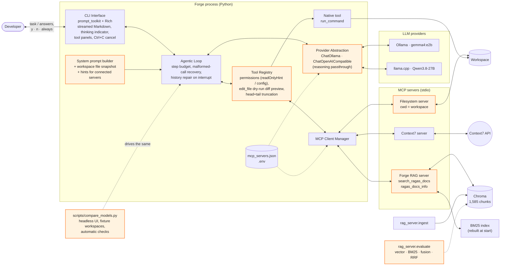

# Forge: Architecture as Built

The original planning-phase diagram is in [planning/02_architecture.md](planning/02_architecture.md). The core design held
up. The changes below came from problems found while testing; new or changed parts are highlighted in the diagram.

## What changed and why

| Change | Why |
|---|---|
| **Workspace snapshot in the system prompt** (new `prompts.py` builder) | In the first end-to-end test, Gemma invented `src/calculator.py` (copying an example path in my own prompt) instead of editing `calculator.py`. With a short file tree of the real workspace in the prompt, the same task went from 10 steps with a wrong file to 5 correct steps. |
| **Server-specific prompt hints only for connected servers** | A precaution: if a server fails to start (or is disabled), the prompt never tells the model to call tools that aren't loaded. |
| **`ChatOpenAICompatible` subclass** | LangChain's `ChatOpenAI` drops llama.cpp's non-standard `reasoning_content` field. The subclass keeps it, so the CLI can show a thinking indicator for both providers. |
| **Permission source: MCP `readOnlyHint` annotations** | The plan used a hand-made list. The filesystem server already annotates each tool, so Forge uses that and falls back to a per-server `read_only` flag in the config (Context7, RAG). |
| **`edit_file` dry run decides whether to ask** | If the dry run fails (the text isn't found), the real edit would fail too, so the error goes straight back to the model instead of asking the user to approve a doomed change. |
| **Filesystem server started with `cwd = workspace`** | Models often use relative paths; these now resolve inside the workspace. |
| **Head+tail truncation of tool output** | Test failures and tracebacks are at the end of command output; keeping only the head hid them. |
| **Second RAG tool `ragas_docs_info`** | Lets the agent (and the demo) show what is indexed: commit, page and chunk counts, embedding model. |
| **RRF retriever and an evaluation module** | Added to measure fusion retrieval against vector-only, BM25-only and rank-based fusion (see `evaluation/rag_retrieval.md`). |
| **Benchmark harness drives the same `Agent`** | Because the loop reports through a UI protocol, a headless UI can run it for the model comparison with no CLI code. |

Nothing was removed from the plan. The state and sequence diagrams in `planning/` still describe the runtime behaviour.
