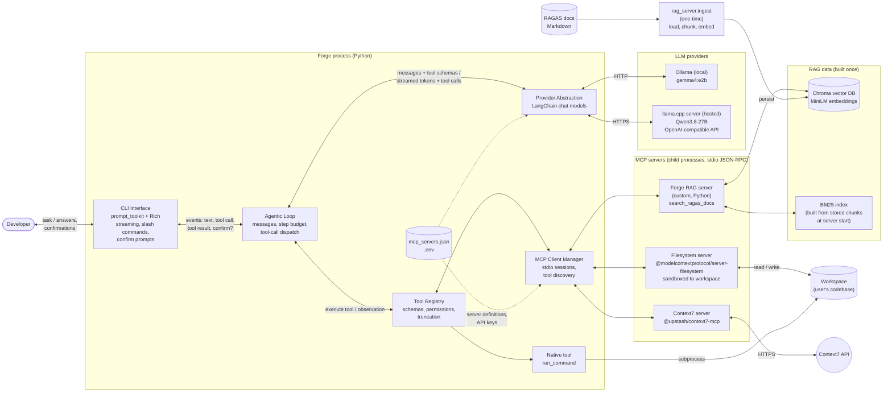

# Forge: System Architecture (original, planning phase)

## Component responsibilities

| Component | Responsibility |
|---|---|
| **CLI Interface** | Reads tasks and slash commands; streams the model's text; renders each tool call (server, tool, arguments) and result; asks for confirmation in `confirm` mode |
| **Agentic Loop** | Holds the conversation; calls the LLM with the tool schemas; executes the returned tool calls in order; appends observations; repeats until the model answers without tool calls or the step budget runs out |
| **Provider Abstraction** | Builds a LangChain chat model for `ollama` or `llamacpp` from the config; `bind_tools` gives every provider the same tool interface |
| **Tool Registry** | Merges MCP tools and native tools; converts MCP JSON Schemas to function schemas; classifies tools as read-only or mutating; truncates outputs |
| **MCP Client Manager** | Starts each configured server, runs `initialize` + `list_tools`, routes `call_tool` to the owning session, and shuts the servers down cleanly |
| **Filesystem server** | Reads, writes, edits (with diff/dry-run) and searches files, restricted to the workspace |
| **Context7 server** | Up-to-date documentation for public libraries |
| **Forge RAG server** | Fusion retrieval (BM25 + vectors) over the RAGAS documentation |
