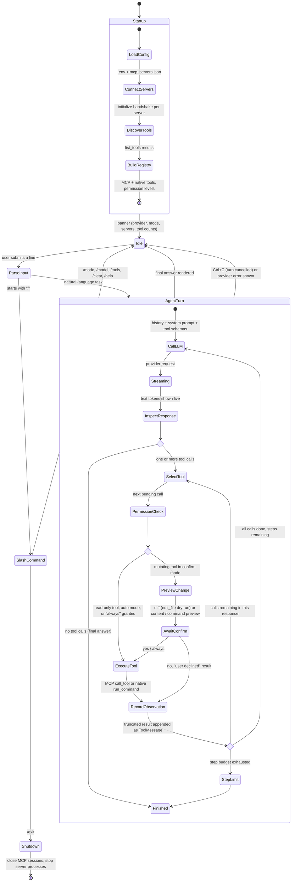

# Forge: State Diagram

This shows how information moves through Forge, from startup through one task (an "agent turn") and back to idle.

## Notes
- **Observations always go back to the model**, including errors and declined confirmations. The model sees what
  happened and can choose a different approach (for example, `create_directory` after a failed `write_file`).
- The **step budget** (default 25 LLM calls per task) stops runaway loops with small models.
- `/clear` empties the conversation history but keeps MCP connections; `/model` swaps the provider without
  restarting the servers.
