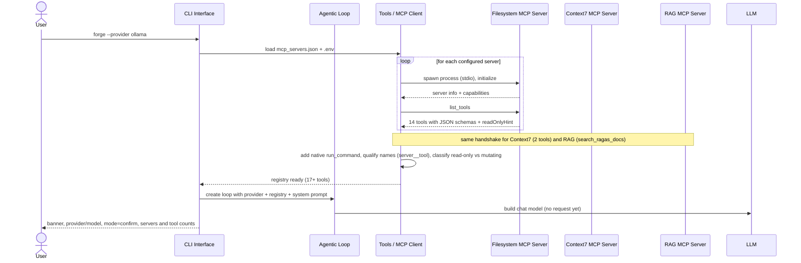
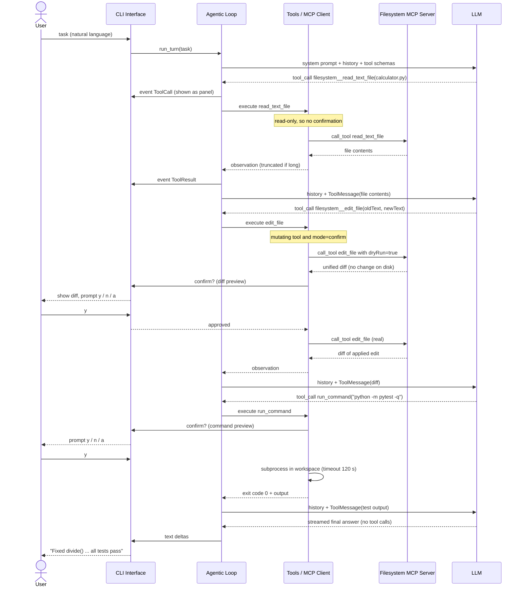
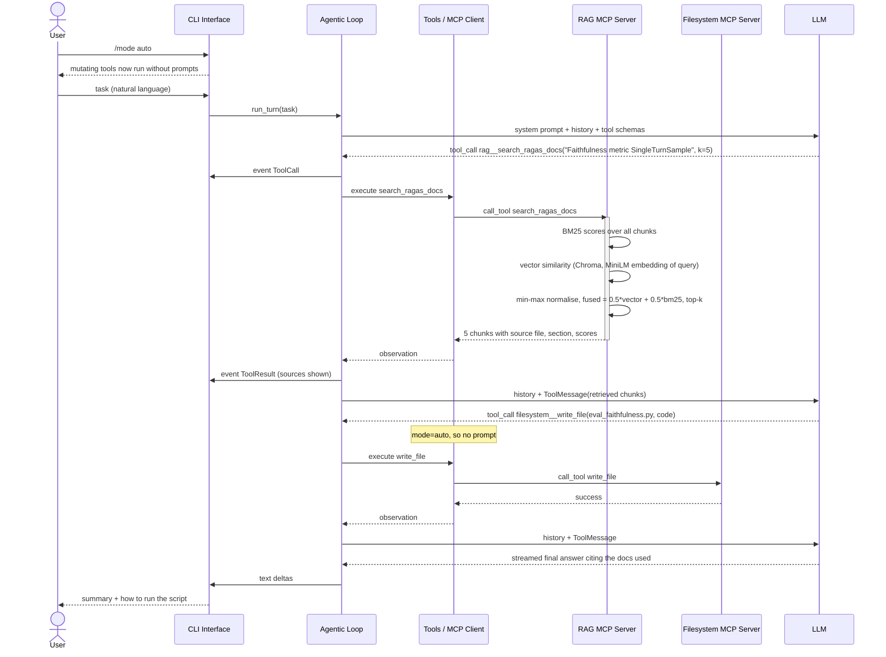
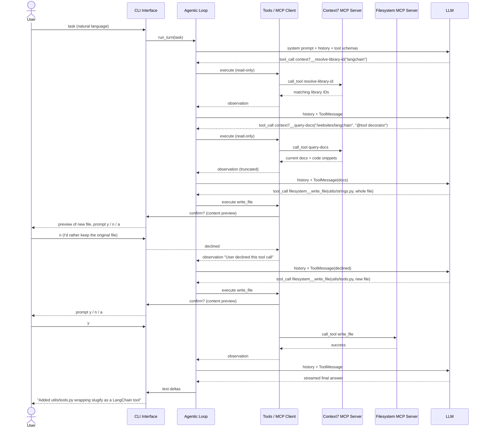

# Forge: Sequence Diagrams

Four end-to-end operations:

1. **Startup and dynamic tool discovery**
2. **Fixing a bug in confirm mode**: filesystem server, diff preview, confirmation prompts, native shell tool
3. **Writing code grounded in the RAG server** (auto mode): custom RAG server, fusion retrieval
4. **Looking up external docs, and a declined change**: Context7 server, user says "no", model adapts

Participants: **User**, **CLI Interface**, **Agentic Loop**, **Tools / MCP Client** (tool registry + MCP client
manager), the **MCP servers**, and the **LLM** (behind the provider abstraction).

---

## 1. Startup and dynamic tool discovery

---

## 2. Fixing a bug in confirm mode

Task: *"divide() in calculator.py crashes on zero. Fix it to raise a ValueError and run the tests."*

---

## 3. Writing code grounded in the RAG server (auto mode)

Task: *"Write eval_faithfulness.py that scores one sample with RAGAS' Faithfulness metric."*

---

## 4. Looking up external docs, and a declined change

Task: *"Add a LangChain @tool wrapper around slugify() using the current LangChain API."*

